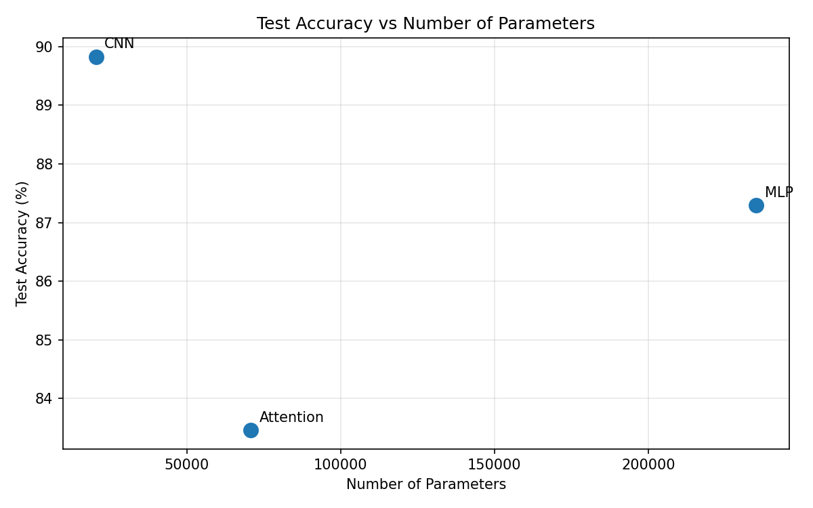
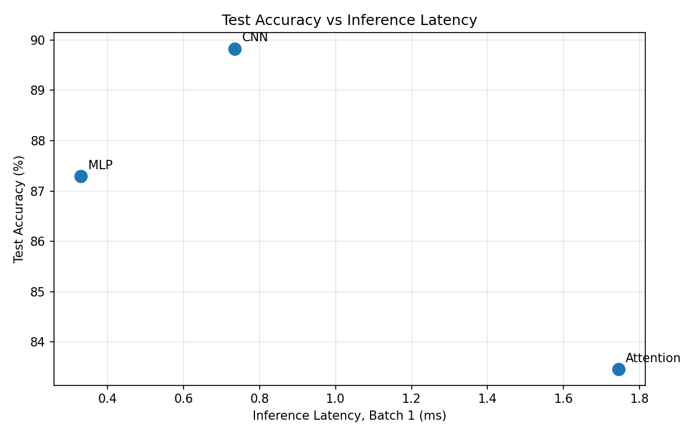

# Lab 3: Architectures and Their Costs

## 1. Goal

The goal of this laboratory was to implement and compare three neural network architectures for Fashion-MNIST image classification: a Multi-Layer Perceptron (MLP), a Convolutional Neural Network (CNN), and an attention-based Transformer model.

The experiment compared model parameters, computational cost, inference latency, and classification accuracy. It also examined the differences between manually estimated FLOPs and profiling results.

## 2. Method

### Dataset and preprocessing

The Fashion-MNIST dataset was loaded using `torchvision.datasets.FashionMNIST`. Images were converted to tensors and normalized using `Normalize((0.2860,), (0.3530,))`.

The official training set of 60,000 images was split into 55,000 training samples and 5,000 validation samples. The official test set contained 10,000 images. The batch size was 128, and the random seed was set to 42.

### Model architectures

**MLP:** The input image was flattened into 784 features. The network used fully connected layers with 256 and 128 neurons, ReLU activations, and a final output layer with 10 classes.

**CNN:** The model used two convolutional layers: the first mapped 1 channel to 16 channels, and the second mapped 16 channels to 32 channels. Each convolution was followed by ReLU and max pooling. The final classifier mapped the resulting 32 × 7 × 7 features to 10 classes.

**Attention:** Each 28 × 28 image was divided into 16 patches of size 7 × 7. Each 49-dimensional patch was projected to 64 dimensions. Two Transformer encoder layers were used, with 4 attention heads and a feed-forward dimension of 128. The patch representations were mean-pooled and passed to a 10-class output layer.

### Training and evaluation

All models were trained for 5 epochs using Adam with a learning rate of 0.001 and batch size 128. Cross-entropy loss was used for classification. Validation accuracy was recorded after each epoch, and final performance was evaluated on the official test set.

Inference latency was measured on CPU using warm-up iterations and repeated forward passes. The median of 100 measurements was used for batch size 1, and the median of 20 measurements was used for batch size 128.

## 3. Results

### Parameter count

| Model | Trainable parameters |
|---|---:|
| MLP | 235,146 |
| CNN | 20,490 |
| Attention | 70,794 |

The assignment specifies a target of 100,000–150,000 parameters for models of similar size. However, the prescribed architectures produce different parameter counts outside this range. The specified layer structures were retained for the experiment, and the actual counts are reported rather than modifying the architectures without authorization.

### FLOPs estimation and profiling

For a fully connected layer, the approximate number of FLOPs is:

\[
\mathrm{FLOPs} \approx 2 \times N_{\mathrm{in}} \times N_{\mathrm{out}}
\]

For a convolutional layer:

\[
\mathrm{FLOPs} \approx
2K^2 C_{\mathrm{in}}C_{\mathrm{out}}H_{\mathrm{out}}W_{\mathrm{out}}
\]

For attention, the cost includes the query, key, and value projections, attention score calculations, and the weighted sum of values.

#### Manual calculations

**MLP — first fully connected layer**

The first layer maps 784 input features to 256 output features:

\[
2 \times 784 \times 256 = 401{,}408
\]

The first fully connected layer therefore requires approximately 401,408 FLOPs per image.

**CNN — first convolutional layer**

The first convolution uses a 3 × 3 kernel, one input channel, 16 output channels, and a 28 × 28 output feature map:

\[
2 \times 3 \times 3 \times 1 \times 16
\times 28 \times 28 = 225{,}792
\]

The first convolutional layer therefore requires approximately 225,792 FLOPs per image.

**Attention — query, key, and value projections**

The model has 16 patches and an embedding dimension of 64. The three projections require approximately:

\[
2 \times 16 \times 64 \times 3 \times 64
= 393{,}216
\]

The query, key, and value projections therefore require approximately 393,216 FLOPs per Transformer layer. This calculation does not include attention score computation, the weighted sum of values, the feed-forward network, or other operations.

#### THOP profiling results

| Model | THOP MACs | Approximate FLOPs (2 × MACs) |
|---|---:|---:|
| MLP | 234,752 | 469,504 |
| CNN | 1,031,744 | 2,063,488 |
| Attention | 50,816 | 101,632 |

THOP reports multiply-accumulate operations (MACs), which are commonly approximated as two FLOPs per MAC. The exact convention can differ between tools.

For MLP and CNN, the reported values are consistent with the general scale of their matrix multiplication and convolution workloads. The manually calculated values above concern individual layers, while the THOP values cover the model operations that the profiler recognizes.

The Attention result must be interpreted with caution. THOP reports 70,794 parameters from the PyTorch model itself, but only 3,850 parameters in its profiling output. Its MAC count is also unexpectedly low because some Transformer operations are not fully counted by the profiler. Consequently, the THOP values for Attention are incomplete and should not be treated as a reliable estimate of its total computational cost.

### Inference latency

The following measurements were obtained on CPU. Latency is reported in milliseconds.

| Model | Batch size 1 (median) | Batch size 128 (median) |
|---|---:|---:|
| MLP | 0.3298 ms | 2.0915 ms |
| CNN | 0.7345 ms | 25.4069 ms |
| Attention | 1.7447 ms | 20.4907 ms |

The MLP had the lowest measured inference latency for both batch sizes. Attention was slower for a single image, while CNN had the highest measured latency for batch size 128 in this experiment.

Latency depends on the hardware, software environment, and runtime conditions. These values describe the tested CPU environment rather than a universal ranking for every device.

### Training and test accuracy

| Model | Final training accuracy | Final validation accuracy | Test accuracy |
|---|---:|---:|---:|
| MLP | 90.1836% | 88.1400% | 87.2900% |
| CNN | 90.6200% | 90.1000% | 89.8300% |
| Attention | 84.4091% | 83.7200% | 83.4600% |

CNN achieved the highest test accuracy at 89.83%. MLP achieved 87.29%, while Attention achieved 83.46% after five epochs.

### Trade-off plots

**Test accuracy vs. number of parameters**

The CNN achieved the highest test accuracy despite having the fewest parameters. MLP used substantially more parameters but did not outperform CNN. Attention had an intermediate parameter count and the lowest test accuracy in this experiment.

**Test accuracy vs. inference latency**

MLP offered the lowest single-image latency, whereas CNN provided the highest test accuracy. Attention was slower than both models for single-image inference and achieved lower accuracy in the five-epoch experiment.

## 4. Architectural Cost and Access Patterns

The architectures differ in how they reuse data and organize computation.

**MLP:** Fully connected layers perform dense matrix multiplications over flattened input features. The model is simple and efficient for single-image inference in this experiment, but it has 235,146 parameters. Flattening also removes the explicit two-dimensional structure of the image before feature extraction.

**CNN:** Convolutions apply shared filters across spatial locations. This weight sharing reduces the number of trainable parameters, and local receptive fields exploit spatial structure in images. The CNN achieved the best accuracy with only 20,490 parameters. Although convolutional operations can be computationally intensive, the model was the most parameter-efficient of the three tested architectures.

**Attention:** The Transformer processes a sequence of image patches. Self-attention allows interactions between patches, while projection and feed-forward layers introduce additional matrix operations. Its runtime depends on both the embedding dimension and sequence length. With only 16 patches, attention score computation is limited by sequence length, but the extra projections and encoder operations still introduce overhead. The incomplete THOP count prevents a fair comparison of its total FLOPs using that tool alone.

From a system-level perspective, parameter count alone does not determine latency. Memory access patterns, operator implementation, tensor shapes, and hardware support all influence runtime. The results show that the CNN provides the best accuracy-to-parameter trade-off, while MLP provides the fastest single-image inference in this CPU experiment.

## 5. Conclusions

1. **CNN was the most parameter-efficient model.** It achieved 89.83% test accuracy with 20,490 trainable parameters, outperforming both MLP and Attention on the test set after five epochs.

2. **MLP provided the lowest measured inference latency.** Its median latency was 0.3298 ms for batch size 1 and 2.0915 ms for batch size 128. However, it used the largest number of parameters and achieved lower accuracy than CNN.

3. **Profiling tools must be interpreted carefully.** THOP provided useful estimates for MLP and CNN, but did not fully account for the Transformer operations in Attention. Manual calculations and tool outputs must be compared at equivalent levels of detail before drawing conclusions about computational cost.

## 6. Reproducibility

The experiment used a fixed random seed of 42, PyTorch, and torchvision. Training metrics and final test accuracy were saved in `results/training_results.csv`. The trade-off plots were generated from the saved CSV file using `src/plot_results.py`, without retraining the models.

The experiment ran on CPU using PyTorch 2.3.1+cpu and torchvision 0.18.1+cpu.
